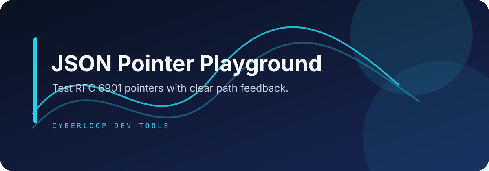

<div align="center">


<a href="https://github.com/CyberLoop-dev/json-pointer-playground">

</a>

<p><strong>Resolve RFC 6901 JSON Pointer expressions against sample JSON documents in a local browser tool.</strong></p>

[](LICENSE)
[](https://github.com/CyberLoop-dev/json-pointer-playground)
[](https://github.com/CyberLoop-dev/json-pointer-playground/stargazers)
[](https://github.com/CyberLoop-dev/json-pointer-playground/commits/main)



</div>

## ✨ Overview

Resolve RFC 6901 JSON Pointer expressions against sample JSON documents in a local browser tool. **JSON Pointer Playground** is a small, focused Node.js and browser JavaScript project. It runs locally, keeps user data in the browser, and is designed to be easy to inspect and extend.

## 🚀 Features

- ✨ 🧭 Resolve pointers against JSON objects and arrays.
- ✨ 🔤 Decode the `~1` and `~0` escape sequences.
- ✨ 🛑 Report invalid escapes, missing keys, and invalid array indexes.
- ✨ 🔒 Keep the JSON document in the local browser tab.

## 🖥️ Demo

Run `npm start`, open `http://127.0.0.1:4173`, and use the controls in the page. Try `/user/roles/1` or `/a~1b/~0key` to test array access and escaped tokens.

## ⚡ Quick Start

```bash
npm start
```

No third-party npm packages are required.

## 🧰 Tech Stack

- **Runtime:** Node.js (built-in HTTP server)
- **Frontend:** HTML, CSS, browser JavaScript
- **Dependencies:** None

## 📁 Folder Structure

```text
json-pointer-playground/
├── assets/overview.svg
├── public/index.html
├── server.js
├── package.json
├── .gitignore
├── LICENSE
└── README.md
```

## 🗺️ Roadmap

- [ ] Add pointer generation from a selected JSON value.
- [ ] Add a small RFC 6901 conformance fixture set.

## 🤝 Contributing

Issues and pull requests are welcome. Keep changes focused, explain behavior changes, and include reproducible steps for reported bugs.

## 📄 License

Released under the [MIT License](LICENSE).

<div align="center">

</div>
